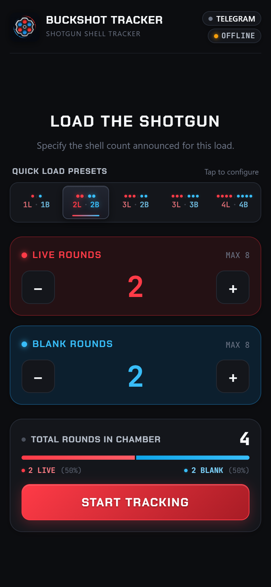
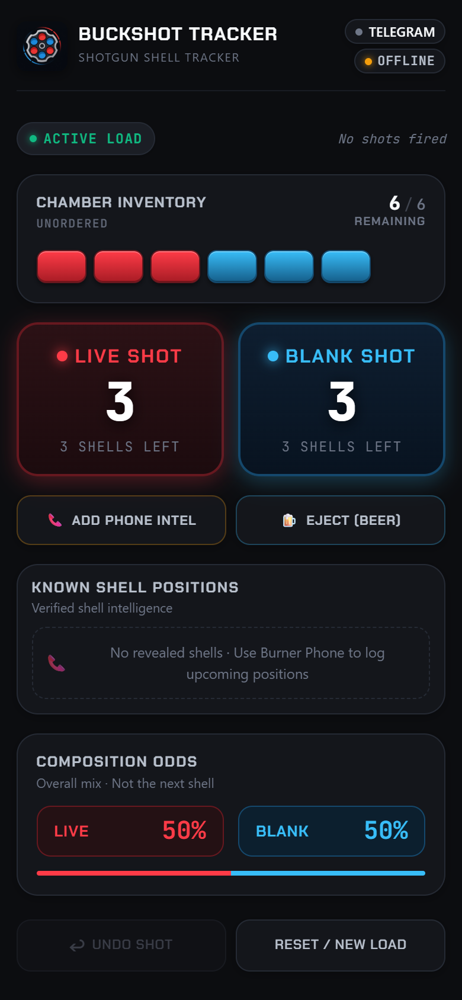
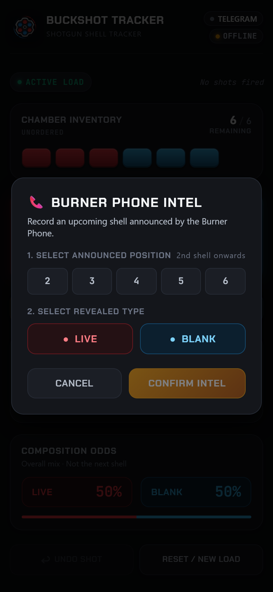
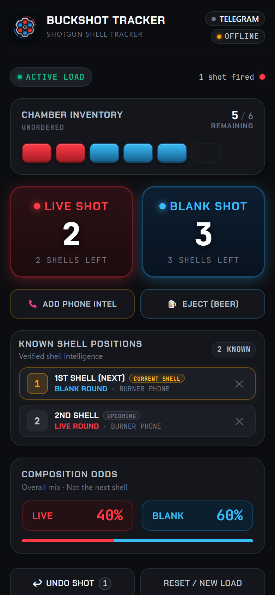
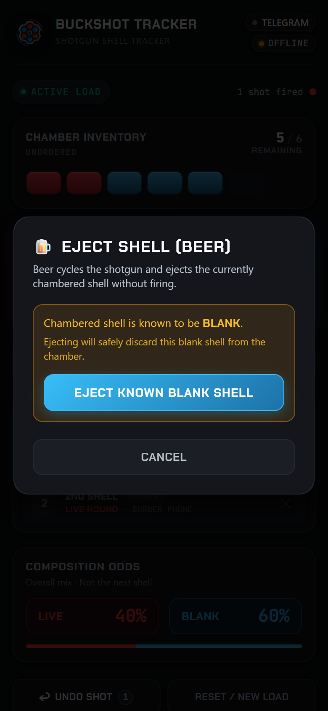
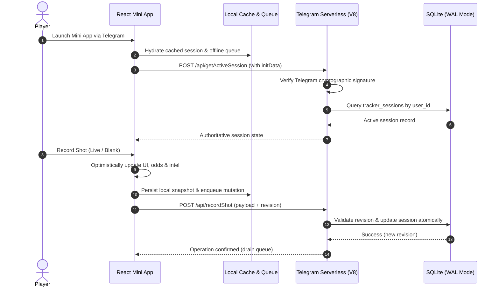

<div align="center">


# BUCKSHOT TRACKER

### Tactical Ammunition & Shell Intelligence Companion for Telegram Mini Apps

A precision tactical companion for **Buckshot Roulette** running on the **Telegram Serverless** platform. Tracks live and blank ammunition inventory, computes real-time composition odds, maintains dynamic Burner Phone positional intelligence across shots and beer ejections, and provides resilient SQLite-backed cloud synchronization.

<br />

<p>
  <a href="#-overview">Overview</a>
  &nbsp;&nbsp;•&nbsp;&nbsp;
  <a href="#-visual-showcase">Visual Showcase</a>
  &nbsp;&nbsp;•&nbsp;&nbsp;
  <a href="#-key-features">Key Features</a>
  &nbsp;&nbsp;•&nbsp;&nbsp;
  <a href="#-how-it-works">How It Works</a>
  &nbsp;&nbsp;•&nbsp;&nbsp;
  <a href="#-architecture">Architecture</a>
  &nbsp;&nbsp;•&nbsp;&nbsp;
  <a href="#-technology-stack">Technology Stack</a>
  &nbsp;&nbsp;•&nbsp;&nbsp;
  <a href="#-getting-started">Getting Started</a>
  &nbsp;&nbsp;•&nbsp;&nbsp;
  <a href="#-testing">Testing</a>
  &nbsp;&nbsp;•&nbsp;&nbsp;
  <a href="#-deployment">Deployment</a>
</p>

<p>
  <a href="https://github.com/Greenhawk5/Buckshot-Tracker/actions/workflows/ci.yml">
    
  </a>
  
  
  
  
  
  
  
</p>

</div>

---

## 🎯 Overview

In *Buckshot Roulette*, survival depends on precise probability calculation, tracking spent shells, and leveraging tactical item intelligence. 

**Buckshot Tracker** provides an instant, zero-friction tactical dashboard accessible directly inside Telegram. It replaces mental tracking with an authoritative digital chamber inventory:

- **Eliminates Counting Errors:** Tracks remaining **Live** (crimson) and **Blank** (cyan) shells in the chamber.
- **Calculates Real-Time Odds:** Updates remaining probability distribution and risk profiles after every shot.
- **Maintains Positional Intelligence:** Accurately tracks shells revealed by the **Burner Phone** as the loadout changes.
- **Models Item Interactions:** Handles **Beer Can** shell ejections and decrements positions automatically.
- **Resilient Offline Architecture:** Operates seamlessly even during cellular drops, syncing state to the cloud via Telegram Serverless when connected.

> **Scope Note:** Buckshot Tracker strictly targets **Single-Player** Buckshot Roulette mechanics as designed by Mike Klubnika. Multiplayer modes are not supported.

---

## 📱 Visual Showcase

<div align="center">

| **01. Setup & Presets** | **02. Active Chamber Tracker** | **03. Burner Phone Intel** |
| :---: | :---: | :---: |
|  |  |  |
| *One-tap dealer presets from 1L/1B to 4L/4B and custom steppers.* | *Chamber capsules, odds breakdown, and tactile shot actions.* | *Log revealed shell positions relative to current chamber.* |

<br />

| **04. Known Shell Positions** | **05. Beer Can Ejection** |
| :---: | :---: |
|  |  |
| *Position 1 CURRENT SHELL status with dynamic shift on fire.* | *Safe ejection verifying Position 1 or manual confirmation.* |

</div>

---

## ✨ Key Features

### 🔴 Chamber Inventory & Odds Engine
- **Visual Ammunition Readout:** Segmented chamber capsules representing remaining live and blank rounds with distinct soft-industrial glow identities.
- **Statistical Composition Odds:** Real-time odds computation displaying exact percentages and semantic tactical descriptions (*Dominant Live*, *High Live Risk*, *50/50 Even Split*, *High Blank Chance*, *Dominant Blank*).
- **Quick-Load Presets:** Pre-configured buttons for standard dealer loads (`1L/1B`, `2L/1B`, `2L/2B`, `3L/2B`, `3L/3B`, `4L/4B`) with custom steppers up to 8 rounds.

### 📞 Burner Phone Intelligence System
- **Relative Positional Tracking:** Records revealed shells by relative position offset (`Position 1` = currently chambered shell, `Position 2` = next in line).
- **Dynamic Position Advancement:** When any shell is fired or ejected, surviving intelligence automatically shifts forward (`pos = pos - 1`).
- **Current Shell Detection:** When Position 1 becomes known, the interface prominently flags it as **CURRENT SHELL**, removing all ambiguity before pulling the trigger.
- **Sanity Validation:** Prevents duplicate entries on the same position and ensures revealed shells do not exceed remaining ammunition counts.

### 🍺 Beer Can Ejection Handling
- **Automated Intelligence Consumption:** If Position 1 is already revealed, tapping Beer Can immediately ejects and logs that shell without extra prompts.
- **Unrevealed Shell Modal:** If Position 1 is unrevealed, an interactive modal allows selecting whether a Live or Blank shell was expelled from the chamber.
- **Defense-in-Depth Verification:** Rejects ambiguous ejections, preserving data integrity across both frontend and backend state.

### ↩️ Deterministic Single-Step Undo
- **Full-Stack Rollback:** Reverses the last action (shot, ejection, or intel change), restoring previous ammunition counts, odds, and positional state.
- **History Badge Indicator:** Displays the reversible action count with layout-stable geometry.

### ☁️ Cloud Persistence & Offline Recovery
- **Telegram Serverless Isolate:** Built natively on `@tgcloud/cli` using V8 serverless isolate functions.
- **SQLite Database:** Authoritative session persistence using SQLite in WAL mode.
- **Optimistic Concurrency:** Version-checked `revision` headers prevent stale writes and race conditions.
- **Offline Mutation Queue:** Local storage queue caches mutations during disconnection and replays them when back online.

---

## 🕹️ How It Works

```text
1. SETUP PHASE           2. ROUND EXECUTION             3. REVELATION & EJECTION
┌─────────────────┐      ┌────────────────────────┐      ┌─────────────────────────┐
│ Dealer reveals  │ ──►  │ Fire Live / Blank      │ ──►  │ Use Burner Phone        │
│ 3 Live, 2 Blank │      │ Chamber updates        │      │ Record Pos 3 is LIVE    │
│ Tap preset 3L/2B│      │ Odds recalculate       │      │ Shells shift on fire    │
└─────────────────┘      └────────────────────────┘      └─────────────────────────┘
                                   │                                  │
                                   ▼                                  ▼
                         ┌────────────────────────┐      ┌─────────────────────────┐
                         │ Undo last shot         │      │ Drink Beer              │
                         │ Rollback state & intel │      │ Eject shell from gun    │
                         │ Invariants preserved   │      │ Known Pos 1 consumed    │
                         └────────────────────────┘      └─────────────────────────┘
```

---

## 🏗️ Architecture



---

## 🛠️ Technology Stack

| Area | Technology |
| :--- | :--- |
| **Frontend UI** |   |
| **Styling & Tokens** |  |
| **Build Tooling** |  |
| **Client Platform** |  |
| **Serverless Runtime** |  |
| **Persistence Engine** |  |
| **Test Suites** |  |
| **E2E & UI Verification** |  |

---

## 📂 Project Structure

```text
Buckshot Tracker/
├── .github/
│   ├── workflows/ci.yml             # GitHub Actions CI (test, typecheck, build)
│   ├── ISSUE_TEMPLATE/              # Bug report and feature request forms
│   ├── PULL_REQUEST_TEMPLATE.md     # Pull request guidelines and checklist
│   └── CODEOWNERS                   # Repository code ownership
├── dist/                            # Production static build deployed to Telegram
├── docs/
│   ├── README.md                    # Documentation index
│   ├── architecture.md              # Technical specifications & data flow
│   ├── development.md               # Local dev environment & operational manual
│   ├── game-mechanics-sources.md    # Authoritative rules & intelligence citations
│   ├── tgcloud-sdk.md               # Telegram Serverless SDK reference
│   ├── photo/                       # Public branding banners and logos
│   └── assets/showcase/             # Application visual showcase screenshots
├── src/
│   ├── app/                         # Application entrypoint & layout
│   ├── components/                  # UI components (AmmoIndicator, KnownShellPositions, etc.)
│   ├── features/tracker/            # Pure counting engine, intelligence logic & tests
│   ├── hooks/                       # React hooks (useTelegram, useTrackerSession)
│   ├── services/                    # Telegram Serverless client & local storage
│   └── styles/                      # Soft industrial design tokens & global CSS
├── tests/                           # Vitest test suites & Puppeteer verification scripts
├── tgcloud/                         # Telegram Serverless backend modules (deployed to cloud)
│   ├── endpoints/                   # Serverless endpoints (recordShot, ejectShell, etc.)
│   ├── handlers/                    # Telegram bot update handlers (message.js)
│   ├── lib/                         # Shared backend helper functions
│   └── schema.js                    # SQLite database schema (sdk/db)
├── CHANGELOG.md                     # Keep a Changelog release history
├── CONTRIBUTING.md                  # Contribution guidelines
├── CODE_OF_CONDUCT.md               # Community standards
├── SECURITY.md                      # Vulnerability reporting policy
├── SUPPORT.md                       # Support & troubleshooting guidance
├── CITATION.cff                     # Citation file format metadata
├── LICENSE                          # MIT License
├── package.json                     # Project manifest (v1.0.0)
├── tgcloud.jsonc                    # Telegram Serverless platform configuration
└── vite.config.ts                   # Vite bundler configuration
```

---

## 🚀 Getting Started

### Prerequisites
- **Node.js:** `20.x` or later (LTS recommended)
- **npm:** `10.x` or later

### Installation
```bash
# 1. Clone the repository
git clone https://github.com/Greenhawk5/Buckshot-Tracker.git
cd Buckshot-Tracker

# 2. Install dependencies
npm install
```

### Local Development Server
```bash
npm run dev
```
Open [http://localhost:5173](http://localhost:5173). In a desktop browser, Telegram WebApp APIs automatically fallback to preview mocks for seamless local testing.

---

## 🧪 Testing

The test suite validates counting logic, positional intelligence shifts, persistence queues, and serverless backend endpoints:

```bash
# Run complete test suite (53 tests)
npm test

# Run TypeScript type check
npm run typecheck

# Build production bundle
npm run build
```

### End-to-End Responsive Verification
Verify layout integrity and intelligence behaviors across simulated mobile viewports:
```bash
node tests/test-intel-verification.mjs
```

---

## ☁️ Deployment

Buckshot Tracker is hosted natively on Telegram Serverless using `@tgcloud/cli`:

```bash
# 1. Authenticate with your Telegram Bot
npx tgcloud login

# 2. Verify cloud drift and status
npm run status

# 3. Apply SQLite schema migrations
npm run migrate

# 4. Deploy static frontend and backend endpoints
npm run deploy
```

---

## 🔒 Security & Privacy

- **Cryptographic Launch Verification:** All requests must include valid Telegram `initData`. Signatures are validated by the serverless platform before endpoint execution.
- **Tenant Isolation:** All database records and session mutations are scoped strictly to the authenticated `user.id`.
- **Zero Client-Side Secrets:** No bot tokens, database credentials, or secret keys are stored in client code or frontend bundles.
- **Responsible Disclosure:** See [SECURITY.md](SECURITY.md) for vulnerability disclosure procedures.

---

## 📖 Documentation Index

- [Architecture & Data Flow](docs/architecture.md)
- [Development & Deployment Manual](docs/development.md)
- [Game Mechanics & Sources](docs/game-mechanics-sources.md)
- [Telegram Serverless SDK Reference](docs/tgcloud-sdk.md)
- [Release History (Changelog)](CHANGELOG.md)

---

## 🤝 Contributing

We welcome bug fixes and documentation improvements. Please read [CONTRIBUTING.md](CONTRIBUTING.md) and our [Code of Conduct](CODE_OF_CONDUCT.md) before submitting a pull request.

---

## 📄 License

This project is open-source software licensed under the [MIT License](LICENSE).  
Copyright © 2026 **Greenhawk5**.

*Buckshot Roulette is created by Mike Klubnika. Buckshot Tracker is an independent fan-made tactical companion.*
