<div align="center">


# BUCKSHOT TRACKER

### Industrial-Grade Tactical Ammunition Companion & Command Center for Telegram Mini Apps

A precision tactical companion for **Buckshot Roulette** running on Telegram's serverless V8 platform. Features real-time chamber inventory tracking, dynamic composition odds computation, Burner Phone positional intelligence, Beer Can ejection modeling, and a full-featured administrative **Owner Command Center** backed by durable SQLite WAL storage.

<br />

<p>
  <a href="#-overview">Overview</a>
  &nbsp;&nbsp;•&nbsp;&nbsp;
  <a href="#-visual-showcase">Visual Showcase</a>
  &nbsp;&nbsp;•&nbsp;&nbsp;
  <a href="#-features">Features</a>
  &nbsp;&nbsp;•&nbsp;&nbsp;
  <a href="#-owner-command-center">Owner Command Center</a>
  &nbsp;&nbsp;•&nbsp;&nbsp;
  <a href="#-architecture">Architecture</a>
  &nbsp;&nbsp;•&nbsp;&nbsp;
  <a href="#-technology-stack">Technology Stack</a>
  &nbsp;&nbsp;•&nbsp;&nbsp;
  <a href="#-getting-started">Getting Started</a>
  &nbsp;&nbsp;•&nbsp;&nbsp;
  <a href="#-testing--quality">Testing & Quality</a>
  &nbsp;&nbsp;•&nbsp;&nbsp;
  <a href="#-deployment">Deployment</a>
</p>

<p>
  <a href="https://github.com/Greenhawk5/Buckshot-Tracker/actions/workflows/ci.yml">
    
  </a>
  
  
  
  
  
  
  
</p>

</div>

---

## 🎯 Overview

In *Buckshot Roulette*, split-second decision-making hinges on exact shell probabilities, tracking spent rounds, and maximizing strategic item revelations.

**Buckshot Tracker** provides an instant, zero-friction companion accessible directly inside Telegram. It replaces mental tracking with an authoritative digital chamber inventory:

- **Eliminates Memory Slip:** Real-time counters tracking remaining **Live** (crimson) and **Blank** (cyan) shells.
- **Dynamic Composition Odds:** Instantaneous percentage calculations and tactical risk descriptors (*Dominant Live*, *High Live Risk*, *50/50 Even Split*, *High Blank Chance*, *Dominant Blank*).
- **Burner Phone Positional Intel:** Relative 1-based chamber position tracking with automatic current-shell flagging and forward index advancement as rounds are discharged.
- **Beer Can Ejection Modeling:** Automated shell consumption if Position 1 is already known, or interactive verification modal for unrevealed ejections.
- **Deterministic Reversible Undo:** Single-step full-stack rollback engine restoring inventory counts, history logs, and positional intelligence without layout shifts.
- **Public About Experience:** Interactive presentation documenting application capabilities, verified technology stack with official brand icons, project links, and encrypted player feedback submission.
- **Owner Command Center:** Comprehensive administrative suite with real-time telemetry, active user anchors (DAU/WAU/MAU), EvilCharts data visualizations, multimedia broadcast campaigns with atomic CAS claiming, user management, audit trails, and data export.
- **Offline Resilience:** Local storage hydration, automatic mutation queuing, and background synchronization upon network reconnection.

---

## 📱 Visual Showcase

Genuine interface captures from the **Buckshot Tracker v1.2.0** production build:

### Player Experience

<div align="center">

| **01. Tactical Ammunition Tracker** | **02. Public About Experience** |
| :---: | :---: |
| <a href="docs/photo/screenshots/01-tracker-main.png">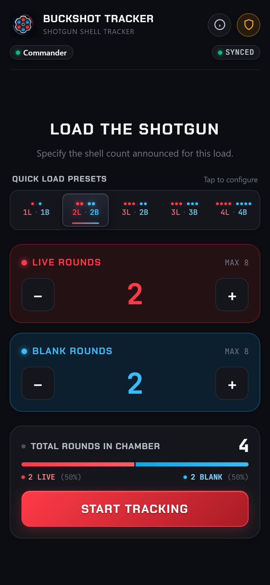</a> | <a href="docs/photo/screenshots/02-about-page.png">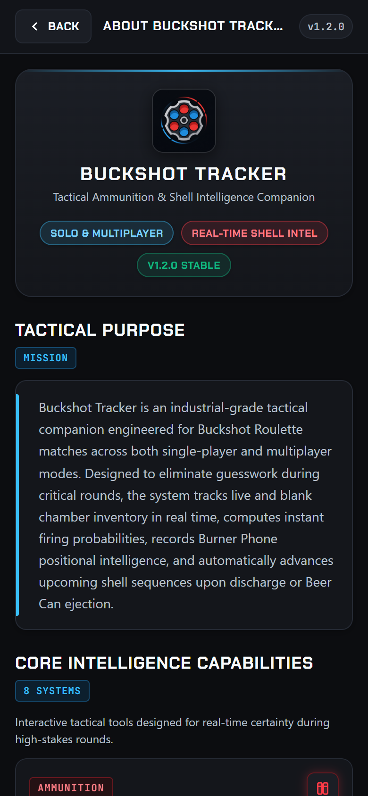</a> |
| *Active chamber readout, live odds gauge, Burner Phone intel, and tactile shot actions.* | *Mission statement, interactive capabilities carousel, tech stack, and encrypted feedback.* |

</div>

### Owner Command Center (Administrative Suite)

<div align="center">

| **03. Overview & Telemetry** | **04. Analytics & Progression** |
| :---: | :---: |
| <a href="docs/photo/screenshots/03-owner-overview.png">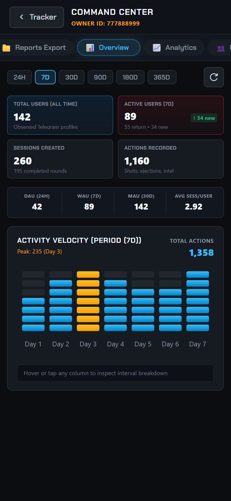</a> | <a href="docs/photo/screenshots/04-owner-analytics.png">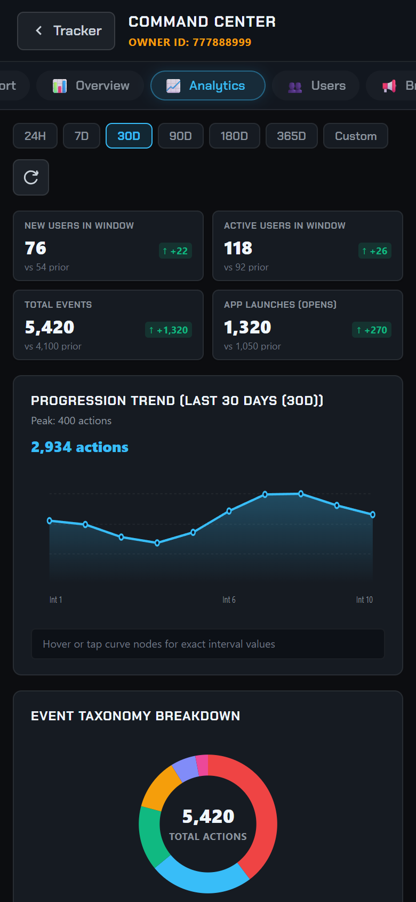</a> |
| *Compact 2×2 KPI grid, 50px telemetry strip (DAU/WAU/MAU), and GridBar activity matrix.* | *Delta comparisons, smooth TacticalAreaChart progression curve, and TaxonomyDonutChart.* |

<br />

| **05. User Management & Drawer** | **06. Broadcast Campaign Manager** |
| :---: | :---: |
| <a href="docs/photo/screenshots/05-owner-users.png">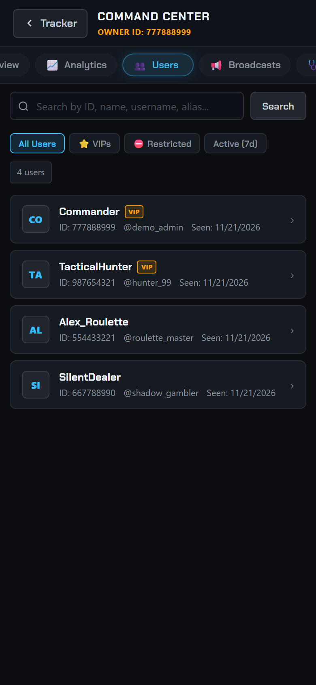</a> | <a href="docs/photo/screenshots/06-owner-broadcasts.png">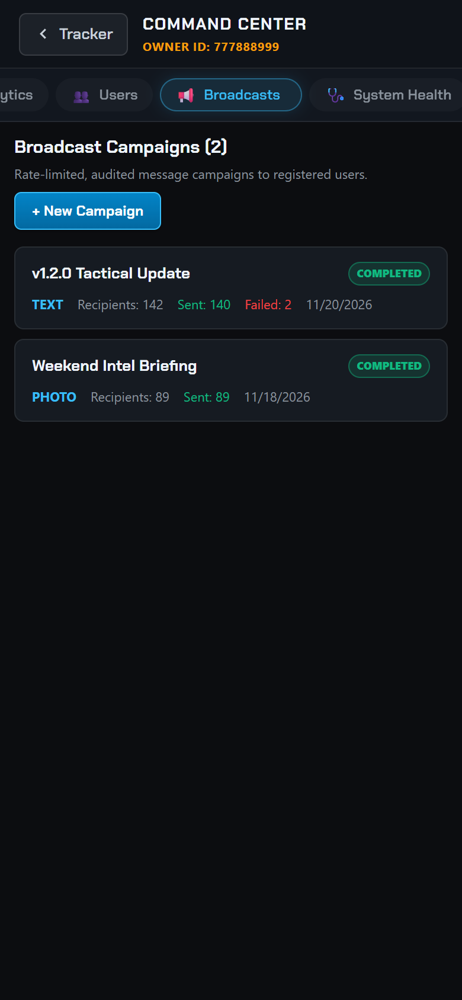</a> |
| *Searchable player directory, Unicode preservation, VIP tagging, and activity timeline drawer.* | *Multi-format composer, audience targeting, pre-send preview, and bounded queue monitoring.* |

<br />

| **07. System Health & Diagnostics** | **08. Operational Settings & Maintenance** |
| :---: | :---: |
| <a href="docs/photo/screenshots/07-owner-health.png">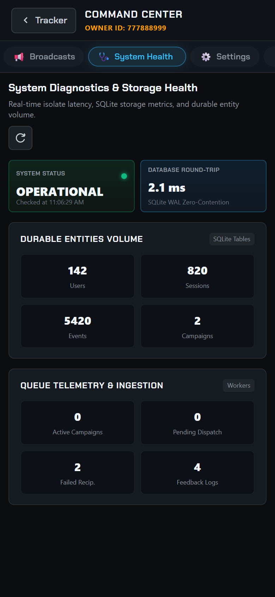</a> | <a href="docs/photo/screenshots/08-owner-settings.png">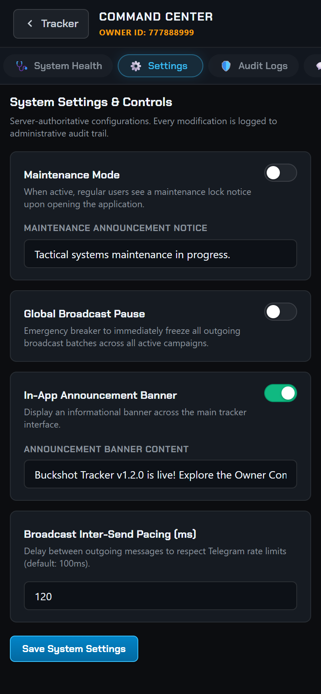</a> |
| *Live SQLite database latency check, entity volume monitoring, and queue telemetry.* | *Server-authoritative maintenance mode toggle, announcement banner editor, and rate pacing.* |

<br />

| **09. Security Audit Logs** | **10. Player Feedback Review** | **11. Reports & Data Export** |
| :---: | :---: | :---: |
| <a href="docs/photo/screenshots/09-owner-audit.png">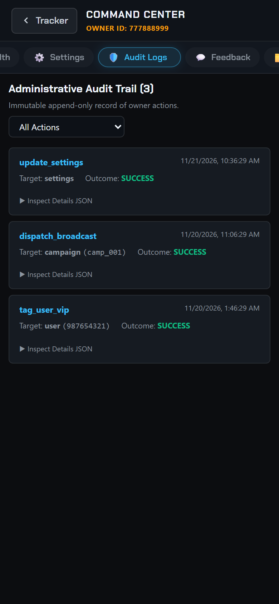</a> | <a href="docs/photo/screenshots/10-owner-feedback.png">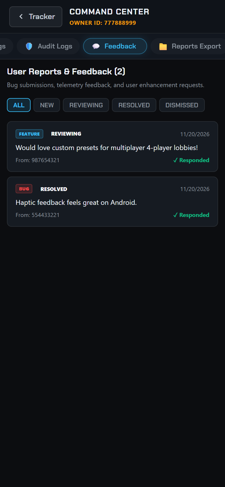</a> | <a href="docs/photo/screenshots/11-owner-exports.png">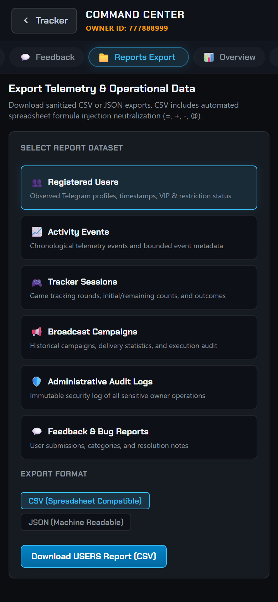</a> |
| *Immutable append-only audit trail with actor IDs, outcomes, and payload JSON viewer.* | *In-app triage inbox for player bug reports and feature ideas with status workflow.* | *One-click CSV/JSON export with automated spreadsheet formula injection neutralization.* |

</div>

---

## ✨ Features

### 🎮 Player Companion Features

- **Tactical Ammunition Readout:** Visual capsule gauges displaying remaining Live and Blank rounds with soft-industrial glowing state accents.
- **Mathematical Composition Odds:** Real-time computation of discharge probability percentages paired with contextual tactical descriptions.
- **Quick-Load Presets & Custom Dial:** Rapid loadout docks (`1L/1B`, `2L/1B`, `2L/2B`, `3L/2B`, `3L/3B`, `4L/4B`) alongside an intuitive custom capacity stepper supporting up to 8 total rounds.
- **Burner Phone Positional Intelligence:**
  - 1-based relative offset indexing from the current chamber forward.
  - Prominent **CURRENT SHELL** status badge when Position 1 is identified.
  - Forward index decrement (`pos = pos - 1`) as shells are fired or ejected.
  - Strict conflict validation preventing duplicate position entries.
- **Beer Can Ejection Workflow:**
  - Immediate deduction and consumption when Position 1 is already known.
  - Interactive verification modal for unrevealed shell ejections.
  - Backend validation rejecting ambiguous ejection calls.
- **Deterministic Reversible Undo:** Full-stack single-action rollback restoring ammunition counts, odds, and positional intelligence without layout shifts.
- **Public About Experience:**
  - Non-overlapping sticky header with responsive layout hierarchy.
  - Infinite auto-scrolling carousels for Core Capabilities and Technology Stack.
  - Developer showcase and repository links to creator portfolio ([alifaniani.ir](https://alifaniani.ir)) and GitHub.
  - Direct feedback modal allowing players to submit encrypted bug reports and ideas.

---

### 🛡️ Owner Command Center (Admin Suite)

Strictly gated server-side exclusively to Telegram user ID `184202422` via cryptographically signed `initData`:

- **Overview & Activity Pulse:** High-density 2×2 metric grid, 50px 4-cell active user anchors strip (`DAU`, `WAU`, `MAU`, `Avg Sess/User`), and discrete `GridBarChart` activity matrix.
- **Advanced Analytics & Visualizations:** Comparative growth metrics with formatted delta indicators, smooth Bézier progression curve (`TacticalAreaChart`), event breakdown distribution (`TaxonomyDonutChart`), and custom date range filters.
- **Adaptive Time-Series Aggregation:** Dynamic interval bucketing (2h, 1d, 3d, 7d, 14d, 30d) across ranges (`24h`, `7d`, `30d`, `90d`, `180d`, `365d`) guaranteeing 7–14 readable columns with true distinct unique user calculation via `Set`.
- **Navbar Stability Engine:** Closest-instance trajectory algorithm eliminating multi-rotation scrolling loops and circular fighting during tab activation.
- **User Registry & Player Detail Drawer:** Searchable directory with Unicode preservation, mutable handle handling, player detail drawer with activity timeline, private owner notes & display aliases, VIP playtester tagging, and restriction controls.
- **Multimedia Broadcast Center:** Campaign composer supporting Telegram text, photo, video, voice, video note, and document formats. Audience segmentation (all, active, inactive, new, VIP), pre-send recipient preview, and atomic compare-and-swap (CAS) batch claiming with rate-limit exponential backoff.
- **System Health & SQLite Diagnostics:** Real-time database latency benchmarking, entity volume counters, queue telemetry, and memory health.
- **Operational Settings:** Server-authoritative maintenance mode toggle (blocking non-owner mutations while permitting admin access), announcement banner editor, emergency broadcast kill switch, and inter-send pacing delay.
- **Administrative Audit Logs:** Append-only security audit trail recording actor ID, action, target entity, timestamp, outcome, and sanitized parameters for all sensitive operations.
- **Feedback Triage System:** In-app inbox for reviewing player submissions, updating status (`new`, `reviewing`, `resolved`, `dismissed`), and recording owner responses.
- **Reports & Export Center:** One-click CSV and JSON exports for Users, Events, Sessions, Campaigns, Audit, and Feedback with automated spreadsheet formula injection neutralization (`=`, `+`, `-`, `@`).

---

## 🏗️ Architecture

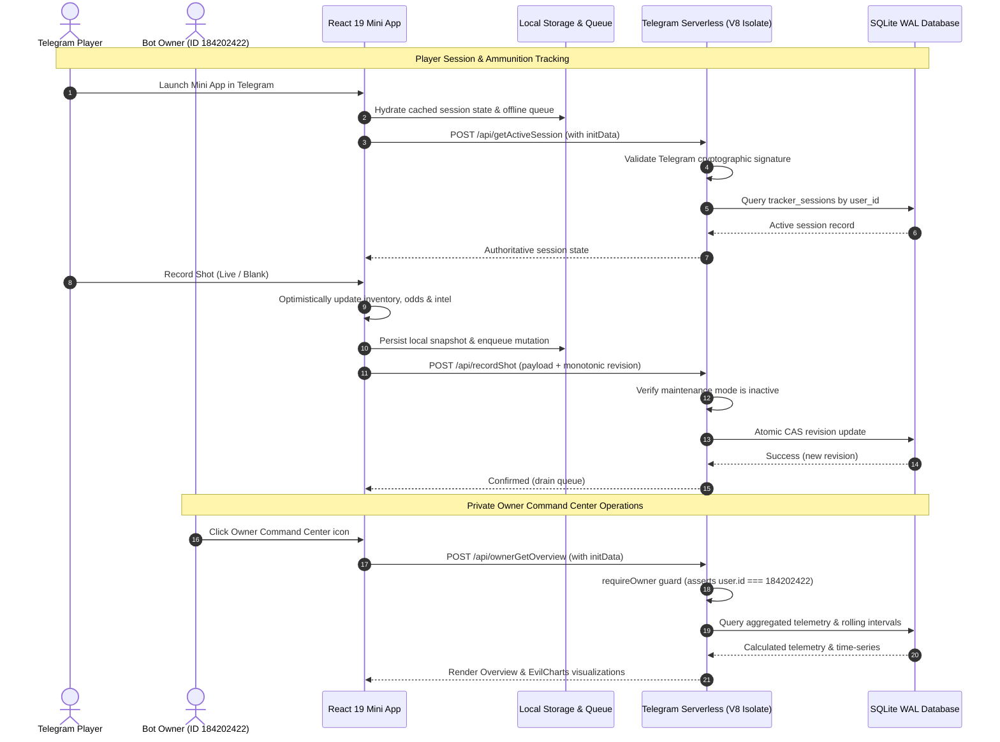

---

## 🛠️ Technology Stack

| Area | Technology | Version | Description |
| :--- | :--- | :--- | :--- |
| **Frontend Framework** | React | `19.3.1` | High-performance reactive component architecture |
| **Programming Language** | TypeScript | `5.8.2` | Strict end-to-end type safety spanning contracts and state |
| **Build & Asset Engine** | Vite | `8.3.8` | Ultra-fast build pipeline generating tree-shaken static assets |
| **Client Platform** | Telegram Mini Apps | WebApp API | Official Telegram client integration with haptic feedback |
| **Serverless Runtime** | Telegram Serverless | `@tgcloud/cli 0.2.0` | Isolated V8 serverless isolate functions |
| **Persistence Engine** | SQLite | WAL Mode | Embedded database with write-ahead logging |
| **Testing Framework** | Vitest | `5.1.1` | High-speed unit and integration test runner (97 tests) |
| **End-to-End Verification** | Puppeteer-Core | `24.x` | Headless Chrome responsive verification across 8 viewports |

---

## 📂 Project Structure

```text
Buckshot Tracker/
├── .github/
│   ├── workflows/ci.yml             # GitHub Actions CI (typecheck, test, build)
│   ├── ISSUE_TEMPLATE/              # Bug report and feature request templates
│   ├── PULL_REQUEST_TEMPLATE.md     # Pull request guidelines and verification checklist
│   └── CODEOWNERS                   # Repository code ownership specification
├── dist/                            # Production static build served as the Mini App
├── docs/
│   ├── README.md                    # Documentation index
│   ├── architecture.md              # Technical specifications & system data flow
│   ├── development.md               # Local development setup & operational manual
│   ├── game-mechanics-sources.md    # Authoritative rules & intelligence citations
│   ├── owner-panel.md               # Owner Command Center specification & reference
│   ├── tgcloud-sdk.md               # Telegram Serverless platform SDK documentation
│   ├── photo/                       # Official branding banners and icons
│   └── screenshots/                 # 11 genuine v1.2.0 interface showcase screenshots
├── src/
│   ├── app/                         # App layout, header responsive design, navigation
│   ├── assets/                      # Bundled image assets and logos
│   ├── components/                  # Shared UI components (AmmoIndicator, SetupScreen, etc.)
│   ├── config/                      # Application constants and configuration
│   ├── features/
│   │   ├── about/                   # Public About page, infinite carousels, feedback modal
│   │   ├── owner/                   # Owner Command Center (8 tactical views & EvilCharts)
│   │   └── tracker/                 # Pure counting engine, probability math & intel logic
│   ├── hooks/                       # React hooks (useTelegram, useTrackerSession)
│   ├── services/                    # Telegram Serverless API clients & local storage
│   └── styles/                      # Design tokens, tactical themes, and responsive CSS
├── tests/                           # Vitest test suites & automated verification scripts
├── tgcloud/                         # Telegram Serverless backend modules (deployed to cloud)
│   ├── endpoints/                   # Serverless endpoints (recordShot, ownerGetOverview, etc.)
│   ├── handlers/                    # Telegram bot update handlers (message.js)
│   ├── lib/                         # Shared backend services (analytics, broadcast, security)
│   └── schema.js                    # Additive SQLite database schema (sdk/db)
├── CHANGELOG.md                     # Keep a Changelog release history
├── CONTRIBUTING.md                  # Contribution guidelines
├── CODE_OF_CONDUCT.md               # Community standards
├── SECURITY.md                      # Security & vulnerability reporting policy
├── SUPPORT.md                       # Support & troubleshooting guidance
├── CITATION.cff                     # Citation file format metadata
├── LICENSE                          # MIT License
├── package.json                     # Project manifest (v1.2.0)
├── package-lock.json                # Deterministic dependency tree
├── tgcloud.jsonc                    # Telegram Serverless platform configuration
└── vite.config.ts                   # Vite bundler configuration
```

---

## 🚀 Getting Started

### Prerequisites
- **Node.js:** `20.x` or later (LTS recommended)
- **npm:** `10.x` or later

### Installation
```bash
# 1. Clone the repository
git clone https://github.com/Greenhawk5/Buckshot-Tracker.git
cd Buckshot-Tracker

# 2. Install dependencies
npm install
```

### Local Development Server
```bash
npm run dev
```
Open [http://localhost:5173](http://localhost:5173). In a desktop browser, Telegram WebApp APIs automatically fallback to preview mocks for seamless local development.

---

## 🧪 Testing & Quality

The automated test suite verifies core ammunition tracking invariants, probability computation, burner phone shifts, persistence queues, atomic CAS claims, and serverless backend authorization:

```bash
# Run complete test suite (97 tests across 8 test suites)
npm test

# Run TypeScript type check (strict mode)
npm run typecheck

# Build production bundle
npm run build
```

### Test Suite Summary
```text
Test Files  8 passed (8)
     Tests  97 passed (97)
  Duration  1.51s

 ✓ src/features/tracker/tracker.test.ts (17 tests)
 ✓ src/features/tracker/intel.test.ts (20 tests)
 ✓ tests/persistence.test.ts (5 tests)
 ✓ tests/backend.test.ts (11 tests)
 ✓ tests/owner-refinements.test.ts (6 tests)
 ✓ tests/analytics-and-users.test.ts (7 tests)
 ✓ tests/frontend-integration.test.ts (6 tests)
 ✓ tests/owner-backend.test.ts (25 tests)
```

---

## ☁️ Deployment

Buckshot Tracker is hosted natively on the Telegram Serverless platform using `@tgcloud/cli`:

```bash
# 1. Authenticate with your Telegram Bot
npx tgcloud login

# 2. Verify cloud drift and status
npm run status

# 3. Apply SQLite schema migrations (interactive)
npm run migrate

# 4. Build frontend and deploy to the cloud
npm run deploy
```

> [!IMPORTANT]
> `npm run deploy` builds the static production bundle and pushes backend code to the cloud. Deploying code never touches the database schema; schema changes are executed separately via `npm run migrate`.

---

## 🔒 Security & Authorization

- **Cryptographic Authentication:** All requests must include valid Telegram `initData`. Signatures are validated by the serverless platform before endpoint execution.
- **Strict Owner Authorization Guard:** Administrative endpoints (`owner*`) enforce `requireOwner`, asserting that the authenticated caller's numeric Telegram ID strictly equals `184202422`. Client-supplied IDs in request payloads or query parameters are ignored.
- **Server-Side Maintenance Mode:** When maintenance mode is active, all non-owner session mutations are rejected server-side with an operational error, preventing state corruption during maintenance windows.
- **Atomic Compare-And-Swap (CAS) Queue Claiming:** Recipient batches in broadcast campaigns are claimed atomically via database CAS updates with lease expirations, preventing race conditions or duplicate deliveries across concurrent serverless workers.
- **Spreadsheet Formula Neutralization:** All CSV exports automatically sanitize leading formula trigger characters (`=`, `+`, `-`, `@`) with prepended apostrophes to prevent CSV injection attacks.
- **Append-Only Security Audit Trail:** Sensitive administrative operations are recorded in an immutable audit table with actor ID, action type, target entity, timestamp, outcome, and sanitized parameters.
- **Zero Client-Side Secrets:** No bot tokens, encryption keys, or private database credentials exist in client code or frontend bundles.

---

## 🗺️ Roadmap & Future Work

- [ ] **Multiplayer Room Intelligence:** Support for 4-player lobbies and turn-order ammunition synchronization.
- [ ] **Custom Presets Editor:** User-defined loadout presets saved to persistent cloud storage.
- [ ] **Internationalization (i18n):** Multi-language localization packs (Spanish, Russian, Persian, German, Chinese).
- [ ] **Telegram Stars Integration:** Optional cosmetics and themed capsule skins using Telegram Stars.

---

## 🤝 Contributing

We welcome bug fixes, documentation improvements, and tactical suggestions. Please review [CONTRIBUTING.md](CONTRIBUTING.md) and our [Code of Conduct](CODE_OF_CONDUCT.md) before submitting a pull request.

---

## 📄 License & Credits

This project is open-source software licensed under the [MIT License](LICENSE).  
Copyright © 2026 **Ali Faniani (Greenhawk5)**.

*Buckshot Roulette is created by Mike Klubnika. Buckshot Tracker is an independent, open-source tactical companion built for educational and utility purposes.*
