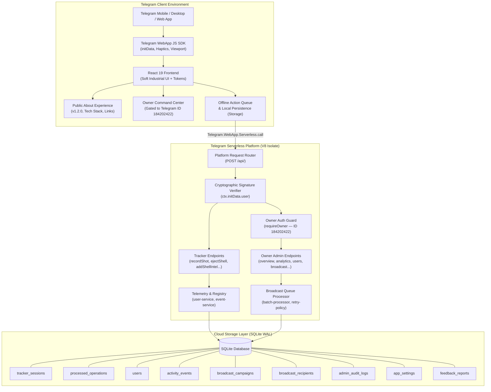

# System Architecture & Technical Specifications — v1.2.0

**Buckshot Tracker** is structured as an offline-first **Telegram Mini App** coupled to a cloud-native **Telegram Serverless** backend backed by embedded **SQLite** in write-ahead logging (WAL) mode.

---

## 1. High-Level Architecture

---

## 2. Frontend Layer (`src/`)

- **UI Framework:** React 19 written in strict TypeScript.
- **Build System:** Vite bundler compiling static assets into `dist/`.
- **Navigation Model:**
  - Ammunition Tracker (Main gameplay screen with Setup, Active Tracker, and Completion).
  - Public About Page (`AboutPage.tsx`): Product identity, tactical capabilities, verified technology stack, canonical versioning (`1.2.0`), creator portfolio (`https://alifaniani.ir`), and GitHub repository.
  - Owner Command Center (`OwnerLayout.tsx`): Telemetry dashboard, analytics, user registry, multimedia broadcast queue, health diagnostics, settings, audit trails, and data export.
- **State Management:** Deterministic domain reducer (`tracker.reducer.ts`) executing ammunition transitions with full undo capability.
- **Offline Resilience:** Local mutations hydrate immediately into memory and local storage. When offline or experiencing transient failures, mutations queue into an idempotent operation log that drains upon network recovery.

---

## 3. Serverless Backend (`tgcloud/`)

- **Runtime:** V8 serverless isolate managed by Telegram Serverless (`@tgcloud/cli`).
- **Endpoint Structure:** Flat, one-level directory layout (`tgcloud/endpoints/<name>.js`) required by `@tgcloud/cli` capabilities.
- **Shared Libraries:** Structured, nested modules under `tgcloud/lib/`:
  - `auth/require-owner.js`: Centralized owner authentication guard.
  - `users/user-service.js`: User registry upsertion, Unicode support, and application restrictions.
  - `analytics/event-service.js`: Event catalog, idempotency, and sanitized metadata.
  - `analytics/metrics-service.js`: Rolling UTC time windows and telemetry calculations.
  - `broadcast/`: Campaign state machine, targeting, batch queue processor, and retry policies.
  - `audit/audit-service.js`: Administrative audit logging.
  - `settings/settings-service.js`: System settings and maintenance controls.

---

## 4. Complete Database Schema (`tgcloud/schema.js`)

All tables are maintained in embedded SQLite in WAL mode:

1. **`tracker_sessions`**: Chamber loadout, live/blank remaining counts, intel JSON, revision, and timestamps.
2. **`processed_operations`**: Client-provided idempotency keys preventing duplicate shot/eject processing.
3. **`users`**: Observed Telegram player profiles, usernames, first/last seen timestamps, private owner notes, VIP flags, and application-level restriction flags.
4. **`activity_events`**: Append-only telemetry log of domain actions (`app_opened`, `session_created`, `shot_recorded`, `shell_ejected`, etc.) with bounded metadata.
5. **`broadcast_campaigns`**: Multimedia broadcast campaigns, message types, target definitions, and delivery counts.
6. **`broadcast_recipients`**: Individual campaign recipient snapshots, status (`pending`, `sending`, `sent`, `failed_retryable`, `failed_permanent`), attempt counts, and lease timestamps.
7. **`admin_audit_logs`**: Immutable security log of owner actions.
8. **`app_settings`**: Server-authoritative application settings (maintenance mode, announcement banner, broadcast pacing).
9. **`feedback_reports`**: Player-submitted bug reports and feature requests.
