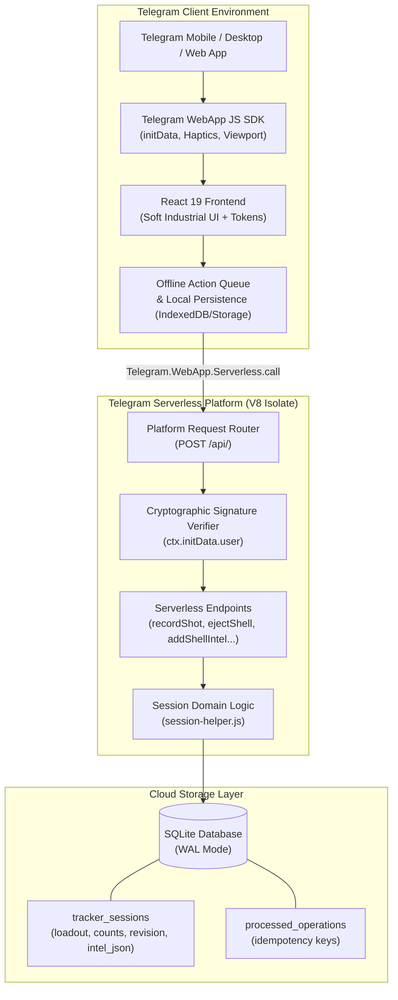

# System Architecture & Technical Specifications

**Buckshot Tracker** is structured as an offline-first **Telegram Mini App** coupled to a cloud-native **Telegram Serverless** backend backed by embedded **SQLite** in write-ahead logging (WAL) mode.

---

## 1. High-Level Architecture

---

## 2. Frontend Layer (`src/`)

- **UI Framework:** React 19 written in strict TypeScript.
- **Build System:** Vite bundler compiling static assets into `dist/`.
- **State Management:** Pure deterministic domain reducer (`tracker.reducer.ts`) executing state transitions with full undo capability.
- **Offline Resilience:** Local mutations hydrate immediately into memory and local storage. When offline or experiencing transient failures, mutations queue into an idempotent operation log that drains upon network recovery.
- **Optimistic Concurrency:** State payloads contain a monotonic `revision` counter. If a cloud mutation detects a revision mismatch, state is re-synchronized to prevent race conditions.

---

## 3. Serverless Backend (`tgcloud/`)

- **Runtime:** V8 serverless isolate managed by Telegram Serverless (`@tgcloud/cli`).
- **Authentication:** Every incoming request passes through platform-verified `ctx.initData`. Callers without valid Telegram cryptographic signatures are rejected before handler invocation (`401 Unauthorized`).
- **Endpoint Design:** Each function under `tgcloud/endpoints/` handles a distinct business operation:
  - `createSession.js`: Initializes a tracking session with selected live and blank counts.
  - `recordShot.js`: Records a fired round, decrements inventory, shifts positional intelligence, and appends to undo history.
  - `ejectShell.js`: Ejects a shell via the Beer Can item. Verifies Position 1 or requires explicit round confirmation; advances remaining intelligence.
  - `addShellIntel.js`: Logs Burner Phone intelligence for a future shell position (1 to remaining shells).
  - `removeShellIntel.js`: Deletes an erroneous or outdated intelligence entry.
  - `undoLastAction.js`: Atomically rolls back the last operation.
  - `getActiveSession.js`: Retrieves current user session state.
  - `abandonSession.js`: Clears active session.
  - `ping.js`: Healthcheck and connectivity test.

---

## 4. Database Schema (`tgcloud/schema.js`)

Persisted on SQLite with WAL mode enabled:

### `tracker_sessions`
| Column | Type | Description |
| ------ | ---- | ----------- |
| `id` | `text primaryKey` | Session unique identifier (`UUID`) |
| `user_id` | `integer not null` | Telegram user identifier (`ctx.initData.user.id`) |
| `initial_live` | `integer not null` | Starting live round count |
| `initial_blank` | `integer not null` | Starting blank round count |
| `current_live` | `integer not null` | Remaining live rounds in chamber |
| `current_blank` | `integer not null` | Remaining blank rounds in chamber |
| `shot_history_json` | `text not null` | JSON array of recorded actions for rollback |
| `intel_json` | `text not null` | JSON array of known positional shell intelligence |
| `status` | `text not null` | Session status (`active`, `completed`, `abandoned`) |
| `revision` | `integer not null` | Monotonic revision counter for optimistic concurrency |
| `created_at` | `text not null` | ISO timestamp of session creation |
| `updated_at` | `text not null` | ISO timestamp of last modification |

### `processed_operations`
| Column | Type | Description |
| ------ | ---- | ----------- |
| `operation_id` | `text primaryKey` | Client-provided idempotency key |
| `user_id` | `integer not null` | Owning Telegram user identifier |
| `created_at` | `text not null` | Timestamp of execution |
