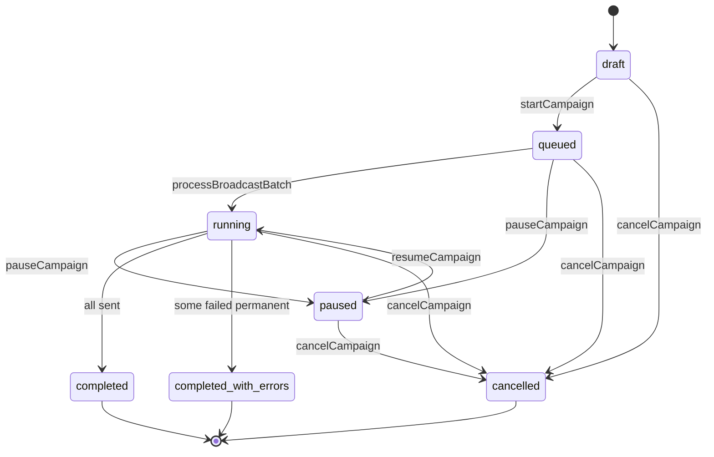

# Multimedia Broadcast Center & Queue Architecture

---

## 1. Overview

The **Broadcast Center** enables the bot owner to compose and dispatch announcements and updates across the registered user base using the Telegram Bot API.

Because the Telegram Serverless platform operates in stateless V8 isolates without persistent background workers or crons, broadcast execution is designed around **persistent database state, bounded batch invocations, and client-orchestrated progress**.

---

## 2. Campaign Lifecycle State Machine



### Recipient States:
- `pending`: Ready to be sent.
- `sending`: Claimed by a worker invocation with an active lease.
- `sent`: Successfully accepted by Telegram Bot API.
- `failed_retryable`: Encountered 429 (rate-limit) or transient error; scheduled with backoff.
- `failed_permanent`: Encountered 403 (blocked by user) or exceeded maximum retry attempts.
- `cancelled`: Campaign was cancelled prior to dispatch.

---

## 3. Resumable Queue & Atomic Compare-And-Swap (CAS) Leasing

1. **Recipient Snapshot:** When a campaign is created, target user IDs are resolved and snapshot into `broadcast_recipients` rows with status `pending`.
2. **Bounded Batches:** Each invocation of `ownerProcessBroadcastBatch` processes up to `batchSize` recipients (default: 5, max: 20).
3. **Atomic Compare-And-Swap (CAS) Claiming:** 
   To guarantee that concurrent batch invocations (e.g. multiple tabs or rapid requests) cannot claim the same recipient, claiming uses conditional database updates:
   ```sql
   UPDATE broadcast_recipients
   SET status = 'sending', lease_until = :leaseTime, updated_at = :now
   WHERE id = :id 
     AND (status = 'pending' OR status = 'failed_retryable' OR (status = 'sending' AND lease_until <= :now))
     AND lease_until <= :now
     AND next_attempt_at <= :now;
   ```
   Only the worker receiving `rowsAffected === 1` acquires the recipient. Any concurrent isolate receives `rowsAffected === 0` and skips to the next candidate.
4. **Expired Lease Recovery:** If an invocation terminates unexpectedly, its lease expires after 60,000 ms (`leaseUntil <= now`). Any subsequent batch run automatically detects expired `sending` rows and re-claims them safely.
5. **Rate Limit Handling:**
   - 429 Too Many Requests: Extracts `parameters.retry_after` and schedules `nextAttemptAt = now + (retry_after * 1000)`.
   - Exponential backoff: Secondary retry delay scales with attempt count (`attempts * 3000 ms`).
   - Max retries: Capped at 3 attempts before marking as `failed_permanent`.
6. **Permanent Failure Classification:**
   - `403 Forbidden` ("bot was blocked by the user", "user is deactivated") immediately transitions to `failed_permanent` without wasting retries.
