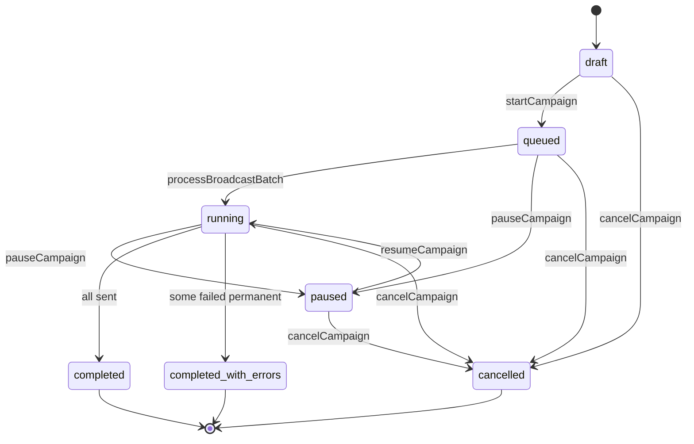

# Multimedia Broadcast Center & Queue Architecture

---

## 1. Overview

The **Broadcast Center** enables the bot owner to compose and dispatch announcements and updates across the registered user base using the Telegram Bot API.

Because the Telegram Serverless platform operates in stateless V8 isolates without persistent background workers or crons, broadcast execution is designed around **persistent database state, bounded batch invocations, and client-orchestrated progress**.

---

## 2. Campaign Lifecycle State Machine

### Recipient States:
- `pending`: Ready to be sent.
- `sending`: Claimed by a worker invocation with an active lease.
- `sent`: Successfully accepted by Telegram Bot API.
- `failed_retryable`: Encountered 429 (rate-limit) or transient error; scheduled with backoff.
- `failed_permanent`: Encountered 403 (blocked by user) or exceeded maximum retry attempts.
- `cancelled`: Campaign was cancelled prior to dispatch.

---

## 3. Resumable Queue & Atomic Leasing

1. **Recipient Snapshot:** When a campaign is created, target user IDs are resolved and snapshot into `broadcast_recipients` rows with status `pending`.
2. **Bounded Batches:** Each invocation of `ownerProcessBroadcastBatch` processes up to `batchSize` recipients (default: 5, max: 20).
3. **Concurrency Guard (Leasing):** Claimed recipients are assigned a lease timestamp (`leaseUntil = now + 60,000 ms`). If an invocation terminates unexpectedly, the lease expires and the recipient is safely reclaimed on the next run.
4. **Rate Limit Handling:**
   - 429 Too Many Requests: Extracts `parameters.retry_after` and schedules `nextAttemptAt = now + (retry_after * 1000)`.
   - Exponential backoff: Secondary retry delay scales with attempt count (`attempts * 3000 ms`).
   - Max retries: Capped at 3 attempts before marking as `failed_permanent`.
5. **Permanent Failure Classification:**
   - `403 Forbidden` ("bot was blocked by the user", "user is deactivated") immediately transitions to `failed_permanent` without wasting retries.
